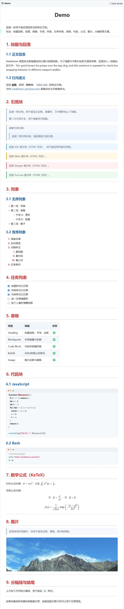
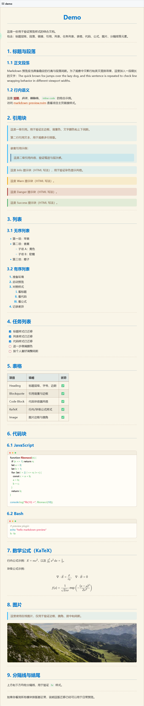

# CSS 样式表备份

[TOC]

此处的样式表参考自`typora`的主题配色，并做了一定修改。  
只适用于 vim/nvim 的`markdown`预览插件[iamcco/markdown-preview.nvim](https://github.com/iamcco/markdown-preview.nvim).

## 使用方法
**记得备份原`markdown.css`文件。**  
将`CSS目录`中的 css 文件下载下来，改名为`markdown.css`，并拷贝到以下路径覆盖原文件。  
`vimfiles\plugged\markdown-preview.nvim\app\_static\markdown.css`   

然后正常使用 vim➕iamcco/markdown-preview.nvim 插件进行预览即可看到效果。

附赠一个`favicon`文件和预览用`demo.md`。

## 1. happysimple
源自：[HappySimple/Typora-theme-Happysimple](https://github.com/HappySimple/Typora-theme-Happysimple)

效果图  

## 2. Alice
源自：[linklinco/Typora-Theme-Alise](https://github.com/linklinco/Typora-Theme-Alise)

效果图  

